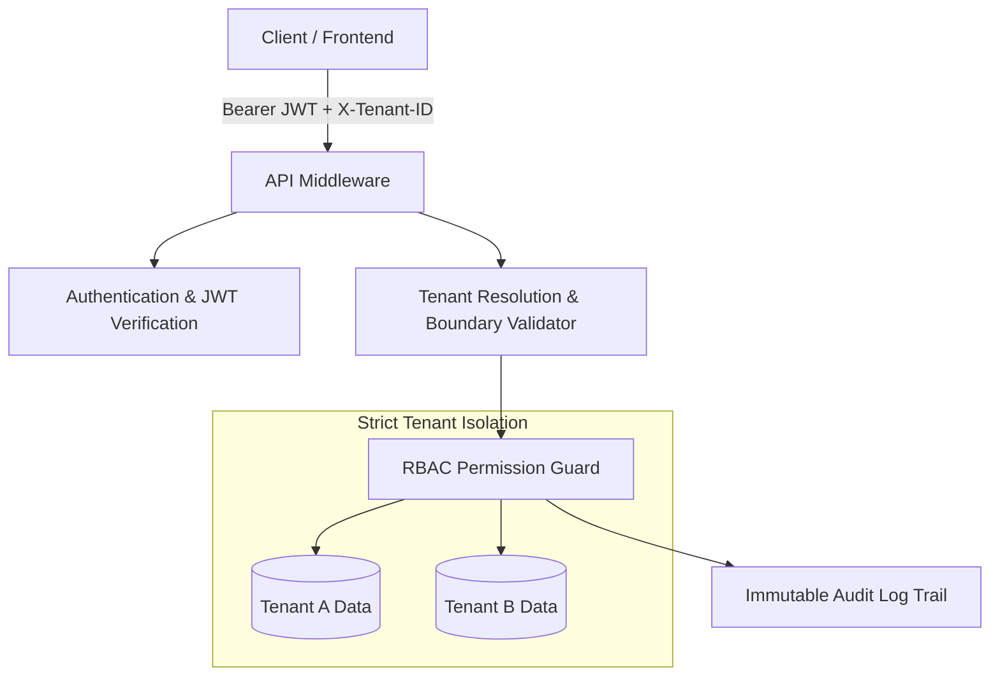

# 🏢 SaaS Multi-Tenant Platform with RBAC & Data Isolation

[](https://github.com)
[](https://nodejs.org)
[](LICENSE)
[]()

An enterprise-ready **B2B Multi-Tenant SaaS Backend** built in modern Node.js (ES Modules) with **Zero Third-Party Dependencies**. Demonstrates strict data isolation across organizations, granular Role-Based Access Control (RBAC), single-use cryptographic invitation tokens, and immutable audit logs.

---

## 🏗️ Architecture & Security Model



---

## 🛡️ Role-Based Access Control (RBAC) Matrix

| Permission | OWNER | ADMIN | MEMBER | VIEWER |
| :--- | :---: | :---: | :---: | :---: |
| **`tenant:delete`** | ✅ | ❌ | ❌ | ❌ |
| **`tenant:update`** | ✅ | ✅ | ❌ | ❌ |
| **`user:invite`** | ✅ | ✅ | ❌ | ❌ |
| **`user:remove`** | ✅ | ✅ | ❌ | ❌ |
| **`resource:create`** | ✅ | ✅ | ✅ | ❌ |
| **`resource:read`** | ✅ | ✅ | ✅ | ✅ |
| **`resource:update`** | ✅ | ✅ | ✅ | ❌ |
| **`resource:delete`** | ✅ | ✅ | ❌ | ❌ |
| **`audit:read`** | ✅ | ✅ | ❌ | ❌ |

---

## ⚡ Core Engineering Highlights

- **Strict Multi-Tenant Isolation:** Guaranteed zero cross-tenant data leakage. Queries are strictly scoped to the tenant identifier.
- **Native Cryptographic Security:**
  - Password hashing utilizing **`scrypt`** with unique cryptographic salts (`node:crypto`).
  - Signed tokens using constant-time HMAC-SHA256 verification (`crypto.timingSafeEqual`) to mitigate timing attacks.
- **Single-Use Team Invitations:** Secure 48-character hex invitation tokens that expire and automatically invalidate after acceptance.
- **Immutable Audit Logging:** Every high-privilege action (`TENANT_CREATED`, `RESOURCE_DELETED`, `INVITATION_ISSUED`) logs user ID, tenant ID, and timestamp.

---

## 🚀 Quickstart

### Run Locally (Node.js 20+)
```bash
# Clone the repository
git clone https://github.com/samilcastillo/saas-multitenant-rbac.git
cd saas-multitenant-rbac

# Run server (No npm install required)
npm start
```
Server runs on `http://localhost:3000`.

### Run with Docker Compose
```bash
docker compose up -d --build
```

---

## 🧪 Automated Testing

Execute the comprehensive test suite verifying RBAC enforcement, cryptographic guarantees, and tenant leakage prevention:

```bash
npm test
```

Test Results:
```text
✔ Security: Password hashing with scrypt and salt verification
✔ Security: JWT Token generation, payload validation, and expiration check
✔ RBAC: Matrix permissions check across hierarchy
✔ Multi-Tenancy: Strict Data Isolation between Tenants
✔ Invitations: Single-use token enforcement and role assignment

ℹ tests 5 | pass 5 | fail 0
```

---

## 📖 API Reference Guide

### 1. Register User
`POST /api/v1/auth/register`
```json
{ "email": "founder@enterprise.com", "password": "SecurePassword2026!" }
```

### 2. Create Organization / Tenant (Assigns OWNER role)
`POST /api/v1/tenants`  
`Authorization: Bearer <TOKEN>`
```json
{ "name": "Stark Industries" }
```

### 3. Issue Team Member Invitation
`POST /api/v1/tenants/:tenantId/invitations`  
`Authorization: Bearer <TOKEN>`
```json
{ "email": "engineer@stark.com", "role": "MEMBER" }
```

### 4. Create Scoped Tenant Resource
`POST /api/v1/tenants/:tenantId/resources`  
`Authorization: Bearer <TOKEN>`
```json
{ "title": "Arc Reactor Blueprint", "content": "Clean energy project specs" }
```

---

## 📄 License
This project is licensed under the MIT License - see the [LICENSE](LICENSE) file for details.
